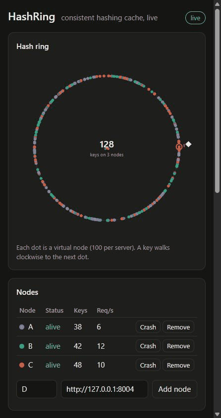
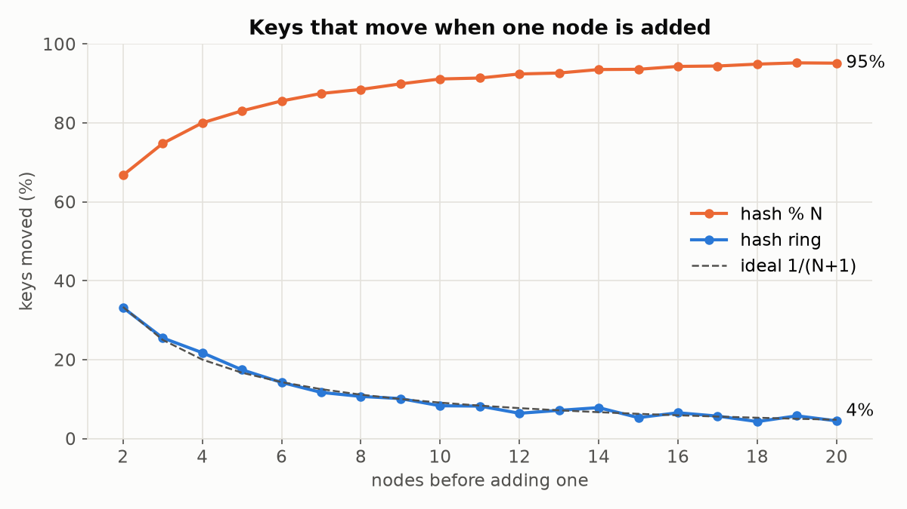
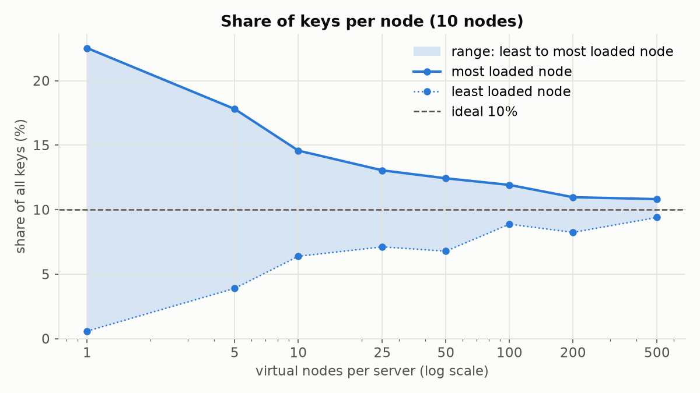
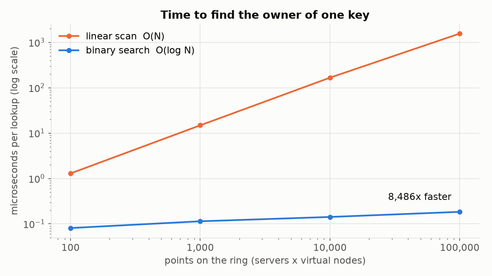
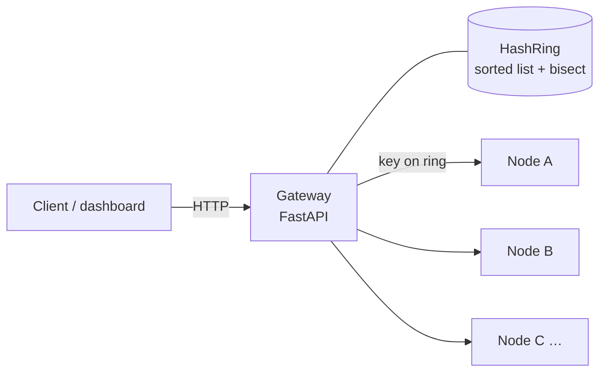

# HashRing

A small **distributed cache built on consistent hashing**, with a live dashboard.
Crash a node and watch only its keys move. Add a node and watch it take just its share.

**[Live demo → hashring.onrender.com](https://hashring.onrender.com)** (free hosting: the first visit may take ~30 s to wake up)


<p align="center"></p>

## The problem

A cache spread over N servers needs a rule: *which server holds key `user42`?*
The obvious rule is `hash(key) % N`. It works until N changes. Add one server and
**almost every key maps to a different server**, so the cache is suddenly empty and
the database takes the full load.

**Consistent hashing** puts servers and keys on one circle (`0 … 2³²−1`). A key belongs
to the first server clockwise from it. Adding or removing a server only moves the keys
next to it: about `1/N` of them. Finding that server is a **binary search** over the
sorted ring, `O(log N)`.

## Results

Measured with `python benchmarks/run.py` (full tables in [benchmarks/RESULTS.md](benchmarks/RESULTS.md)).

| Claim | Number |
|---|---|
| Adding a 21st node moves only the keys it now owns | **4.5%** of keys move with the ring vs **95.1%** with `hash % N` |
| Virtual nodes spread keys evenly (10 nodes, ideal 10%) | 1 vnode: 0.6%–22.5% per node · 100 vnodes: 8.9%–11.9% |
| Binary search finds the owner fast | 100,000 points: **0.18 µs** vs 1,561 µs for a linear scan (~8,500×) |





## Architecture



- **Clients talk only to the gateway.** It asks the ring who owns a key and forwards the request.
- **Nodes** are small FastAPI services that keep keys in memory.
- **Health checks** every second take dead nodes off the ring and put recovered ones back.
- **Failover:** if a node does not answer, the gateway removes it and retries on the next owner, so writes keep working.
- **Rebalancing:** a node that joins pulls the keys it now owns; a node removed on purpose hands its keys over first.

## Run it

**Docker (every node in its own container):**

```bash
docker compose up --build
```

**Or with Python 3.11+:**

```bash
python -m venv .venv
.venv\Scripts\activate            # Linux/macOS: source .venv/bin/activate
pip install -e ".[dev]"
python scripts/run_cluster.py
```

Then open **http://localhost:8000** (or just use the [live demo](https://hashring.onrender.com)). Start the simulator, press **Crash** on a node,
add a spare node, or type a key to see the binary search step by step.
API docs are at `/docs`.

## API (gateway)

| Method | Path | What it does |
|---|---|---|
| `GET` `PUT` `DELETE` | `/keys/{key}` | Read / write / delete a key on its owner node |
| `GET` | `/locate/{key}` | Ring position and owner, without touching nodes |
| `GET` | `/cluster` | Nodes, ring points, stats (`?refresh=true` for fresh key counts) |
| `GET` | `/events?since=…` | Node up / down / removed events |
| `POST` `DELETE` | `/nodes`, `/nodes/{name}` | Add a node, remove one gracefully |
| `POST` | `/nodes/{name}/crash` | Kill a node (only if it runs with `--allow-crash`) |
| `POST` | `/simulator` | Start/stop fake traffic, set requests per second |

## Design decisions

- **md5, not Python's `hash()`** – `hash()` changes on every restart; a ring must give the same answer everywhere.
- **100 virtual nodes per server** – the benchmark shows 1 → 100 vnodes cuts the most loaded node from 2.25× to 1.19× the average; 500 only gets to 1.08× for 5× the points.
- **Membership changes behind one `asyncio.Lock`** – a health check and an admin "remove" never edit the ring at the same time.
- **Short connect timeout (0.3 s)** – one dead node must not stall all traffic while we wait for it.
- **One process on small hosts** – Render's free plan has 0.1 CPU and 512 MB. Six Python processes did not start in time there, so the one-container image runs all nodes and the gateway as separate HTTP servers inside one process: it starts in ~13 s and uses ~46 MB (tested with `docker run --cpus 0.1 --memory 512m`). Docker Compose still runs one container per node.
- **Safety limits for a public demo** – keys are limited to safe characters, values to 1 KB, each node to 5,000 keys; the crash endpoint is off unless a node is started with `--allow-crash`.

## Limitations (on purpose, for a learning project)

- **No replication:** when a node crashes, its data is lost. Writing each key to 2 nodes would fix this.
- **In memory only:** like Memcached, a restarted node starts empty.
- **Single gateway:** it is a single point of failure; real systems run several.
- **During rebalancing** a key that is still moving can miss for a moment.

## Tests

```bash
pytest -q
```

53 tests. Gateway tests use an in-memory fake cluster (`tests/fake_cluster.py`):
real node apps, no network, nodes can be killed and restarted in one line.
The binary search is checked against a plain linear scan on 2,000 keys.

## Project layout

| Folder | What it holds |
|---|---|
| `hashring/` | Core algorithm: ring, `bisect`, virtual nodes |
| `node/` | Cache node service |
| `gateway/` | Routing, health checks, rebalancing, simulator, HTTP API |
| `dashboard/` | HTML + D3.js live view |
| `benchmarks/` | Benchmark script, charts, results |
| `scripts/` | Run a local cluster, live demos |
| `tests/` | pytest tests |
