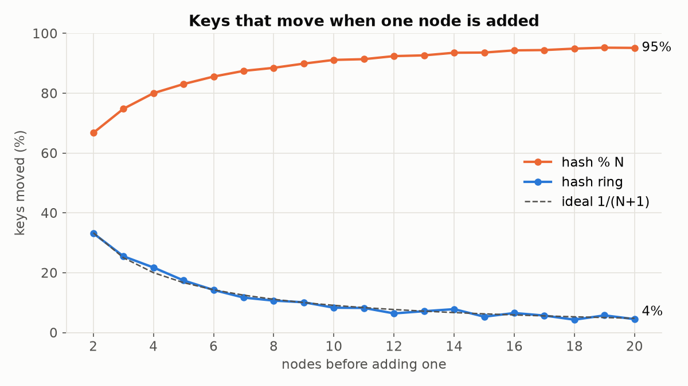
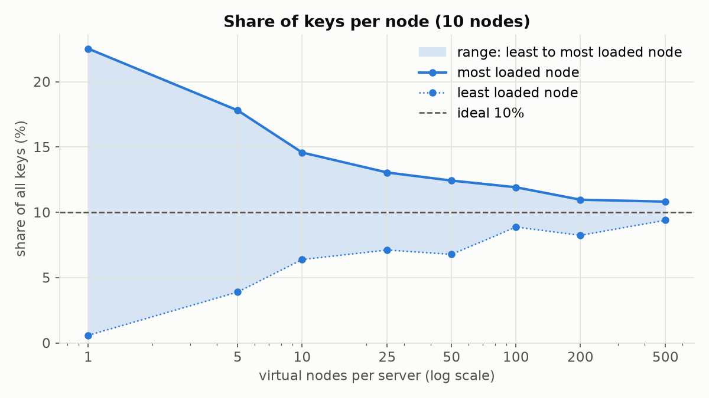
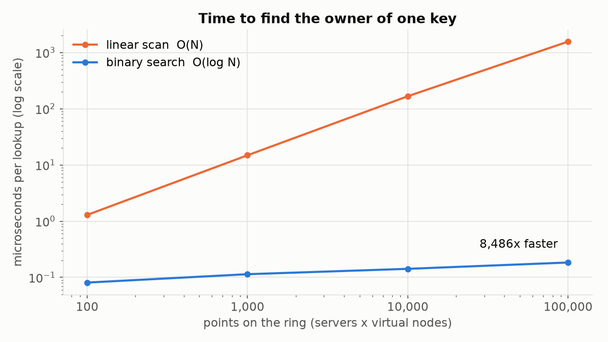

# Benchmark results

Generated by `python benchmarks/run.py`.

## 1. Keys moved when one node is added (20,000 keys)

| Nodes | hash % N | hash ring | ideal 1/(N+1) |
|---:|---:|---:|---:|
| 2 → 3 | 66.7% | 33.2% | 33.3% |
| 3 → 4 | 74.8% | 25.5% | 25.0% |
| 4 → 5 | 80.0% | 21.7% | 20.0% |
| 5 → 6 | 83.0% | 17.4% | 16.7% |
| 10 → 11 | 91.1% | 8.3% | 9.1% |
| 15 → 16 | 93.6% | 5.3% | 6.2% |
| 20 → 21 | 95.1% | 4.5% | 4.8% |

## 2. Load balance vs virtual nodes (10 nodes, 100,000 keys, ideal 10%)

| Virtual nodes | Least loaded | Most loaded | Std dev | Most loaded ÷ average |
|---:|---:|---:|---:|---:|
| 1 | 0.6% | 22.5% | 7.29 | 2.25× |
| 5 | 3.9% | 17.8% | 4.71 | 1.78× |
| 10 | 6.4% | 14.6% | 2.60 | 1.46× |
| 25 | 7.1% | 13.0% | 1.55 | 1.30× |
| 50 | 6.8% | 12.4% | 1.64 | 1.24× |
| 100 | 8.9% | 11.9% | 1.01 | 1.19× |
| 200 | 8.2% | 11.0% | 0.79 | 1.10× |
| 500 | 9.4% | 10.8% | 0.41 | 1.08× |

## 3. Lookup time: binary search vs linear scan

| Points on ring | Binary search | Linear scan | Speed-up |
|---:|---:|---:|---:|
| 100 | 0.08 µs | 1.3 µs | 16× |
| 1,000 | 0.11 µs | 14.8 µs | 130× |
| 10,000 | 0.14 µs | 166.5 µs | 1,172× |
| 100,000 | 0.18 µs | 1,561.4 µs | 8,486× |

Times depend on the machine; the shape of the curves does not.
